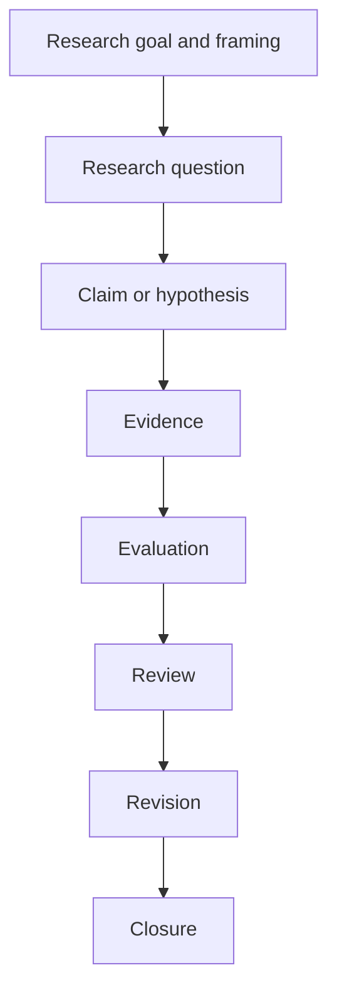

# ERPL vs. Google AI Co-Scientist
## From scientific hypothesis generation to research production

**Public architectural comparison | 27 November 2026**

This comparison uses Google's own definition of AI Co-Scientist and its peer-reviewed 2026 Nature paper as the reference. It compares design objectives and publicly documented evidence, not the results of a head-to-head performance experiment.

## 1. What is an AI Co-Scientist?

In February 2025, Google Research introduced AI co-scientist as a Gemini 2.0-based multi-agent scientific collaborator. Its central objective is to help human scientists discover original knowledge by proposing new hypotheses and ways to test them, taking existing evidence and researcher-defined objectives into account. [1, 2]

The subsequent Nature publication describes a structured scientific reasoning system for generating hypotheses and planning experiments. Its experimental program includes real laboratory validation. It is not simply a literature summarizer, a question-answering chatbot, or a paper-writing assistant. [3]

This is a specific, established implementation of the broader idea of AI-assisted scientific collaboration, not a universal industry standard defining every system called a co-scientist.

### How Google's Co-Scientist works

The system uses six specialized agent roles: Generation, Reflection, Ranking, Evolution, Proximity and Meta-review. Together they explore candidate hypotheses, criticize and compare them, refine promising ideas and synthesize proposed directions. A Supervisor schedules work and allocates computation. Google describes a tournament mechanism and iterative debate, with increasing inference-time computation supporting further refinement. [4, 5]

Researchers define goals, supply constraints and feedback, and guide the investigation. The system supports persistent context and external research tools; it should not be characterized as a stateless chatbot. [3]

## 2. What is ERPL?

**ERPL (Energetic Research Production Line) is designed to organize the production of defensible research results, from research questions to documented, reviewable deliverables.**

Its design is based on the Energetic Paradigm (EP), with emphasis on persistent research state, explicit evidence, constraints, review, revision and closure. Rather than considering a promising hypothesis the sole endpoint, ERPL treats it as one intermediate object within a broader research-production lifecycle.

ERPL is intended to connect scientific investigation with qualification, manuscript preparation, critical review and the management of research deliverables. This is a design objective, not a statement that every component is publicly available or scientifically qualified.

The executable public version represents the following sequence:

The public engine records supplied claims and evidence, creates stage artifacts, and verifies their integrity. It does not independently generate scientific hypotheses, gather new scientific evidence, or establish that a conclusion is scientifically true.

## 3. Architectural comparison

| Dimension | Google AI Co-Scientist | ERPL |
|---|---|---|
| Primary objective | Advance scientific discovery through novel, testable hypotheses | Organize the full production and qualification of research deliverables |
| Research input | Natural-language scientific objective, expert constraints and feedback | Research question, claims, evidence and research-state requirements |
| Core architecture | Gemini-based specialized agents and iterative hypothesis tournaments | EP-based research lifecycle with explicit state, evaluation, review and closure; private research mechanisms not disclosed |
| Main optimization emphasis | Improve hypothesis quality, novelty and experimental suitability | Intended to improve continuity, traceability, evidence quality and readiness of the research deliverable |
| Literature and external evidence | Search and specialist resources support grounded hypothesis development | Evidence handling is represented publicly; autonomous retrieval and scientific evaluation belong to research components not demonstrated here |
| Criticism and revision | Agent debate, reflection and candidate evolution | Explicit review, revision and closure records; deeper research critique is an intended capability |
| Memory | Persistent context during extended reasoning | Explicit research-state and provenance artifacts; broader private memory capabilities not validated by this demo |
| Human participation | Scientific experts steer the process and conduct validation | Researchers define objectives and judge scientific results; public workflow does not replace expert judgment |
| Intended output | Prioritized hypotheses, research proposals and experimental plans | Documented research output, potentially including manuscripts and qualification records |
| Experimental validation | Published biomedical laboratory studies with scientists | No comparable laboratory validation established by the public demo |
| Public evidence | Nature paper, scientific evaluations and Google documentation | Downloadable workflow demonstration and scoped engineering reports |
| Access | Google Cloud documentation describes restricted preview access [5] | Public demo can be cloned and executed locally without an API key; private engines are not distributed |

The distinction is one of emphasis rather than a mutually exclusive division. Co-Scientist has review, memory, experimental planning and iterative refinement. ERPL also intends to support discovery. The question is how those capabilities are integrated, evaluated and brought to a research deliverable.

## 4. Two different success criteria

**Co-Scientist:** Has the system identified a promising scientific direction that experts can test?

**ERPL:** Can a research project progress from a question through evidence and revision to a defensible deliverable, with a documented reason to close, continue or reject it?

Scientific closure requires adequate evidence and expert assessment. File integrity and a completed workflow are not substitutes for scientific validity.

A potential integration would use hypothesis-generation tools to propose research directions and a production workflow to manage evidence, qualification and subsequent deliverables. No integration with Google's system is claimed.

## 5. The ERPL research-production family

| Component | Intended role | Public evidence boundary |
|---|---|---|
| ERPL | Research lifecycle and closure | [Executable public workflow](README.md) |
| ERPL-P | Research qualification and manuscript-quality gates | [Scoped engineering report](https://github.com/EnergeticParadigm/energetic-paradigm-research/blob/main/engineering-status/2026-11-24/erpl-p.md); scientific qualification pending in that snapshot |
| ERPL-R | Scientific manuscript review and critique | [Scoped engineering report](https://github.com/EnergeticParadigm/energetic-paradigm-research/blob/main/engineering-status/2026-11-24/erpl-r.md); not a public qualified peer-review service |
| ERPL-E | Engineering acceptance, revision and delivery | Intended engineering lifecycle support; no public executable in this demo |
| ERPL-Med | Medical research lifecycle | [Scoped engineering report](https://github.com/EnergeticParadigm/energetic-paradigm-research/blob/main/engineering-status/2026-11-24/erpl-med.md); no clinical efficacy or regulatory claim |

## 6. Evidence and maturity

Google's 2026 Nature paper reports biomedical work involving drug repurposing, liver-fibrosis targets and a bacterial gene-transfer mechanism relevant to antimicrobial resistance. These findings are meaningful evidence for its hypothesis-generation approach, while laboratory findings are not equivalent to clinical efficacy. [3, 6]

ERPL's current public artifact establishes a narrower result: the execution of a represented research lifecycle, preservation of supplied inputs and verification of generated artifacts. The November 27, 2026 macOS demonstration successfully ran a default and a user-supplied case and detected a modified output. This is engineering evidence, not an independently established scientific-discovery result.

No comparative result establishes that ERPL generates better hypotheses, discovers more original knowledge, requires less compute, or produces more accurate research than Co-Scientist.

## 7. How to compare them empirically

A useful future evaluation would give both systems identical research objectives and access to equivalent evidence and resources, distinguish shared scientific tasks from ERPL-specific workflow tasks, and record actual time and cost.

Shared tasks should be scored for novelty, factual support, testability, expert-rated scientific validity and experimental outcomes where available. Research-production tasks should additionally measure revision completeness, traceability, reproducibility and whether closure decisions are justified. A blinded domain-expert assessment and preservation of negative results are necessary to support comparative claims.

This is an evaluation proposal, not an experiment already conducted.

## 8. Why the distinction matters

For research institutions and industrial R&D teams, hypothesis generation is valuable, but research projects also require evidence management, quality assessment, revision and accountable delivery.

Co-Scientist provides a scientifically validated precedent for AI-enabled hypothesis development. ERPL seeks to address the broader organizational problem of producing defensible research deliverables. Its differentiation will depend on demonstrating these capabilities in actual research projects, not on architectural terminology alone.

**In short: Co-Scientist emphasizes discovering promising scientific directions; ERPL emphasizes turning research into defensible deliverables.**

## Sources

1. Google Research (2025), [Accelerating scientific breakthroughs with an AI co-scientist](https://research.google/blog/accelerating-scientific-breakthroughs-with-an-ai-co-scientist/).
2. Gottweis et al. (2025), [Towards an AI co-scientist](https://arxiv.org/abs/2502.18864), arXiv:2502.18864.
3. [Accelerating scientific discovery with Co-Scientist](https://doi.org/10.1038/s41586-026-10644-y), Nature (2026).
4. Google DeepMind (2026), [Co-Scientist: A multi-agent AI partner to accelerate research](https://deepmind.google/blog/co-scientist-a-multi-agent-ai-partner-to-accelerate-research/).
5. Google Cloud, [Accelerate research and development with Co-Scientist agent](https://docs.cloud.google.com/gemini/enterprise/docs/co-scientist?hl=en), accessed November 27, 2026.
6. Nature Portfolio, [AI research assistants that may accelerate scientific discovery](https://www.natureasia.com/en/info/press-releases/detail/9330) (2026).
7. Energetic Paradigm, [ERPL Public v1](https://github.com/EnergeticParadigm/ERPL), [research engineering evidence](https://github.com/EnergeticParadigm/energetic-paradigm-research/tree/main/engineering-status/2026-11-24) and [ERPL executable demo](README.md).

*Prepared as a public comparison by the ERPL project. This is not a peer-reviewed comparative evaluation or a Google endorsement.*
