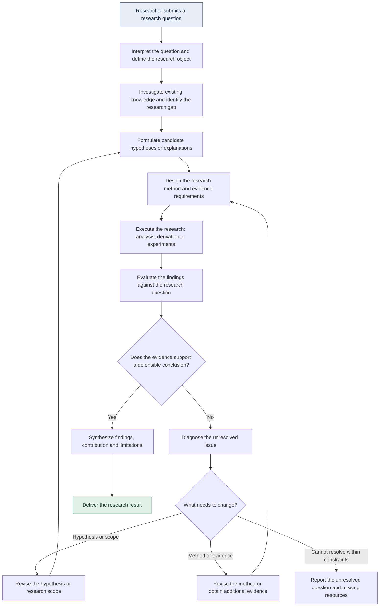

# 05 — ERPL: Research Process Demonstration

**ERPL (Energetic Research Production Line)** is an Energetic Paradigm research architecture for transforming a research question into a defensible research result through a sustained AI-enabled research process.

**We are currently seeking research collaborators and investors. ERPL is not currently offered as a publicly accessible research service.**

[Explore the step-by-step research demonstration](demonstration/README.md) · [View the Mermaid research process diagram](demonstration/RESEARCH_PROCESS.md)

Each stage of the worked demonstration has its own Markdown research output. The example illustrates our human-directed AI research practice; it is not a standalone autonomous runtime execution.

## 1. What does the researcher provide?

A research question or research assignment in natural language. The researcher may specify the objective, relevant background, constraints, available resources, and expected deliverable. The researcher does not need to supply a completed research plan, the desired conclusion, or a sequence of instructions for every research step.

## 2. How ERPL processes the research question

The following describes the human-directed, AI-executed research approach used in our EP research practice. The stages describe the research work and its outputs, rather than a prescribed sequence of software calls. The appropriate research method depends on the question.



## 3. What actually happens at each stage?

| Stage | Research activity | Observable output |
|---|---|---|
| Interpret the question | Determine what is being investigated, what would count as an answer, and which constraints are relevant. Separate the question from assumptions embedded in its wording. | Defined research object and scope |
| Investigate prior knowledge | Examine relevant literature or available source material. Identify competing explanations, established findings, unresolved problems, and what would be genuinely new. | Research landscape and knowledge gap |
| Formulate hypotheses | Develop plausible explanatory claims or candidate solutions. Identify the consequences that would distinguish them from alternatives. For exploratory or theoretical research, formulate the propositions or questions to investigate. | Candidate hypotheses or propositions |
| Design the research | Choose a suitable analytical, mathematical, computational, or empirical method. Specify the evidence needed to support or reject the claims, and identify resource requirements. | Research design and evidence plan |
| Execute the research | Perform the actual derivation, analysis, simulation, computation, or experiment, using available tools and research materials. Record results and distinguish observed evidence from assumptions. | Research findings and supporting evidence |
| Evaluate the findings | Determine whether the findings support the claims, distinguish alternatives, or reveal a contradiction. Consider scope, uncertainty and limitations. | Evidence-based scientific judgment |
| Revise and continue | When the evidence is insufficient or contradictory, identify the cause, revise the hypothesis or method, and undertake the next appropriate research action. Stop when further work requires unavailable resources or cannot be justified. | Revised research question, hypothesis, experiment, or explicit unresolved finding |
| Deliver the result | Synthesize what has been learned, what is supported, what remains uncertain, and how the findings address the original question. | Research report, derivation, computational result, or documented negative finding |

## 4. Why the research process matters

ERPL does not treat the first generated answer as the final research result. A finding changes the state of the research: an unsuccessful experiment may invalidate a hypothesis, a new observation may require a different method, and missing evidence may require the work to stop or continue in a different direction.

The objective is not simply to generate text. It is to organize the research work so that the conclusion depends on what the investigation actually establishes.

The researcher defines the objective and can redirect the work when needed. EP-enabled AI performs the research activities using available models, information and tools. External experiments, unavailable data, or decisions requiring human judgment may still require researcher participation.

## 5. What can we show today?

Our human-directed EP research practice is the basis of this process description. It is not a claim that every activity above is available as a single, independently autonomous public software endpoint.

For a concrete example of an already implemented research mechanism, the [experimental research evidence](RESEARCH_CAPABILITY_DEMO.md) records fresh execution of the private ERPL V1 runtime on 27 November 2026: an initial hypothesis was contradicted, a revised hypothesis and experiment were generated under the existing discovery policy, and a second experiment was executed. The report also includes competing-hypothesis evaluation and cross-dataset execution. These predefined examples substantiate specific portions of the research loop, rather than the entire natural-language research process.

- [Measured experimental results](research_results.json)
- [Public research portfolio](https://github.com/EnergeticParadigm/energetic-paradigm-research)
- [Architectural comparison with Google AI Co-Scientist](ERPL_vs_AI_CoScientist.md)

## 6. Related capabilities

ERPL organizes research production. ERPL-P supports the development and qualification of research papers; ERPL-R is concerned with scientific peer review; ERPL-E addresses engineering development and delivery. They are complementary capabilities, not interchangeable names for the same task.

## Optional public workflow sandbox

The existing public reference implementation is available for users who wish to inspect the structure of research artifacts. It does not execute the complete research process described above or generate scientific findings from an arbitrary question.

```sh
git clone https://github.com/EnergeticParadigm/DEMO.git
cd DEMO/05-erpl
python3 run.py
```

No public research service, proprietary implementation, internal research records, or private model access is provided by this demonstration.
