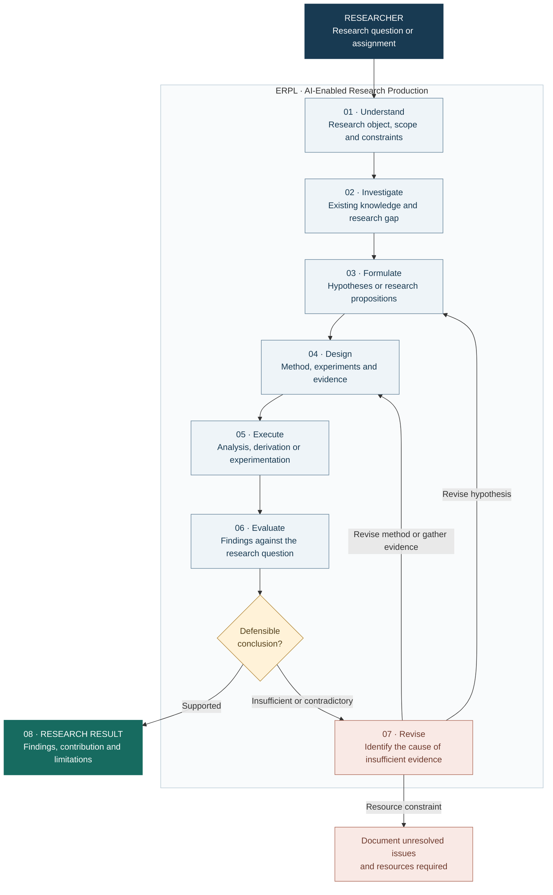

# ERPL — Research Process Demonstration

**From a research question to a defensible research result**

The stages describe the research process, not a fixed sequence of API calls. The researcher sets the assignment and may redirect the work; EP-enabled AI performs research with available information and tools. Evidence changes the research direction. Unsupported claims are revised or left unresolved rather than being forced into a conclusion.

**Research demonstration for prospective collaborators and investors — not a public research service.**
