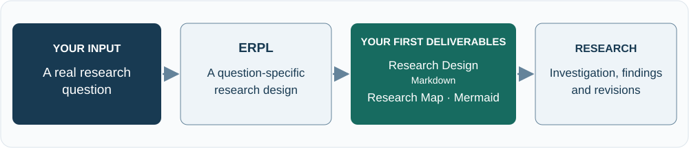

# ERPL — Energetic Research Production Line

**Give us your research question. See how ERPL would investigate it.**

ERPL is an AI-enabled research architecture developed under Energetic Paradigm. It organizes research from an initial question through research design, investigation, evidence evaluation, revision and the delivery of defensible findings.

Your research question determines the research design and its corresponding Mermaid research map. The diagram above describes the demonstration interaction, not a predetermined research plan.

**What you receive**

- **Research design:** the proposed methods, evidence requirements and rationale specific to your question.
- **Research map:** a question-specific diagram showing dependencies and evidence-driven decisions.
- **Research progress:** findings and revisions as the investigation proceeds.
- **Research results:** documented findings, supporting evidence and unresolved questions.

Share your research question directly with our team. The demonstration uses our human-directed AI research practice; no software installation or access to a private runtime is required.
