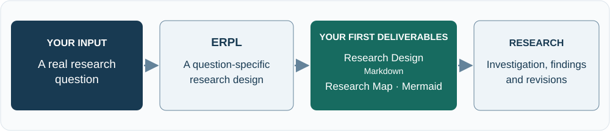

# ERPL — Demonstration

## Energetic Research Production Line

**Give us your research question. See how ERPL would investigate it.**

ERPL (Energetic Research Production Line) is an AI-enabled research architecture developed under the Energetic Paradigm (EP). It organizes research from an initial question through research design, investigation, evidence evaluation, revision and the delivery of defensible findings.

Unlike a static demonstration with a predetermined question and answer, this demonstration begins with **your own research question**.

*This diagram shows the demonstration interaction, not the research plan for your question. Your own research map is created after we receive your question.*

## What will you receive?

| Deliverable | What it reveals |
|---|---|
| Research Design · Markdown | How ERPL approaches your specific question, what methods it selects, why, and what evidence is needed |
| Research Map · Mermaid | The actual research tasks, their dependencies and how different findings change the subsequent investigation |
| Research Progress · Markdown | The investigations performed, evidence obtained and changes to the research direction |
| Research Results · Markdown | The findings, their contribution, supporting evidence and unresolved limitations |

## Bring your own question

Share a research question with our team in your existing conversation. You do not need to supply a research plan, a predetermined answer or install any software.

**We are currently seeking research collaborators and investors.** Demonstrations are conducted through our team; ERPL is not currently offered as a publicly accessible research service.

## Explore the evidence

- [Public research portfolio](https://github.com/EnergeticParadigm/energetic-paradigm-research)
- [Experimental research results from the private ERPL runtime](RESEARCH_CAPABILITY_DEMO.md)
- [Illustrative research example](demonstration/01-research-question.md) · [Literature and hypotheses](demonstration/02-literature-and-hypotheses.md) · [Evidence and analysis](demonstration/03-evidence-and-analysis.md) · [Research conclusion](demonstration/04-revision-and-result.md)

The general workflow and previously prepared example are background material. The question-specific demonstration uses our human-directed, AI-executed EP research practice; it is not a claim of a fully autonomous standalone endpoint. Research design and subsequent findings depend on the actual question, available evidence and resources. No question-specific design or findings are claimed before a question is received. Please share confidential research material privately.
